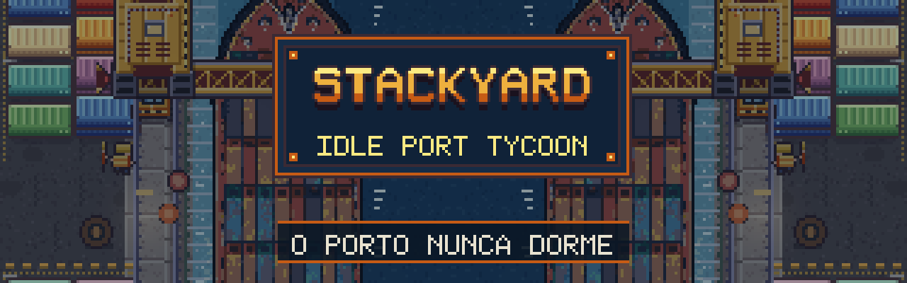
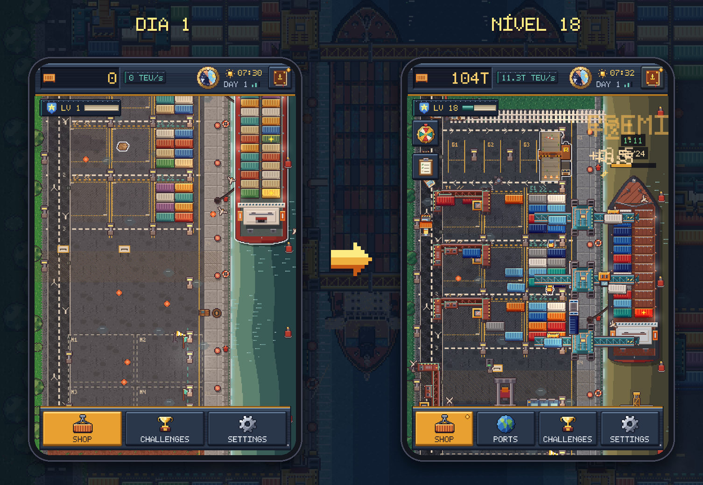
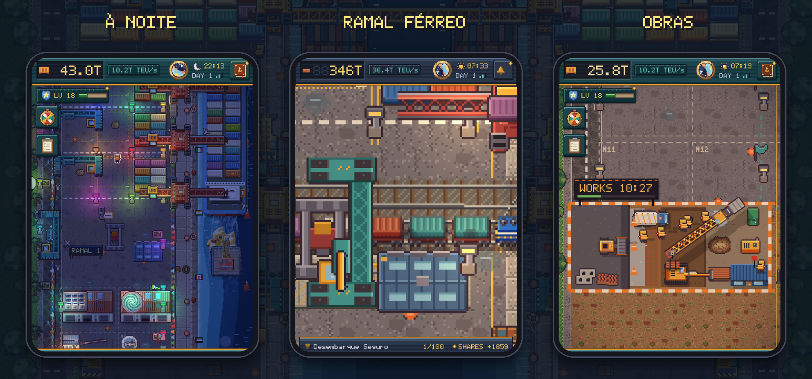
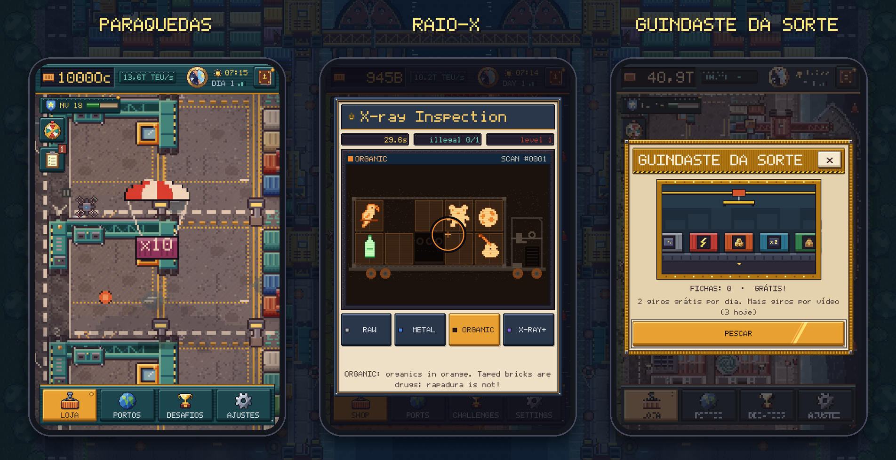
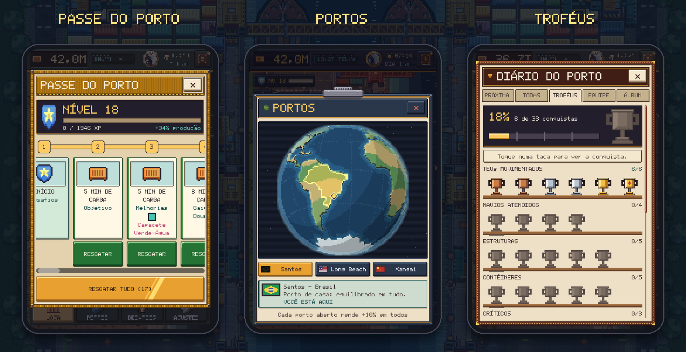

<div align="center">



### Do cais vazio ao caos lindo de contêiner empilhado.

Um idle de terminal portuário em pixel art, feito para jogar no celular, em retrato, com uma mão só.

<a href="https://harborclick.169-58-108-100.sslip.io/jogar/"></a>


</div>

---

## ⚓ O jogo

Um navio encosta no berço com **24 contêineres**. Você toca no casco e a carga
desce, caixa por caixa, até o pátio. Depois embarca a exportação até fechar o
convés, ouve a buzina e vê o navio partir. Aí chega o próximo.

Com o tempo, o terminal vazio vira um porto de verdade: portêineres, reach
stackers, caminhões no gate, um ramal ferroviário, obras abrindo terreno novo e
uma equipe que trabalha mesmo quando você fecha o jogo.

<p align="center">
  
</p>

## ✨ Por que é gostoso de jogar

<table>
<tr>
<td width="50%" valign="top">

**👆 Todo toque tem peso**<br>
Combo de até ×3 com faíscas e um som que sobe de tom. A carga premiada brilha
no convés e paga ×5. O fim de cada escala vem com buzina, confete e câmera
tremendo.

</td>
<td width="50%" valign="top">

**🏗️ Comprar é construir**<br>
Cada máquina nova vira uma obra no mapa, com tapume e cronômetro. Tocar na obra
acelera. Nada surge do nada: a carga chega por navio, caminhão ou trem, e as
compras descem de paraquedas.

</td>
</tr>
<tr>
<td valign="top">

**📦 Cada caixa é uma caixa**<br>
Todo contêiner tem identidade própria, com origem e destino. Um navio nunca leva
de volta a carga que trouxe, e o save guarda cada uma exatamente uma vez.

</td>
<td valign="top">

**🌙 O porto nunca dorme**<br>
Tem ciclo de dia e noite, chuva, gaivotas e um gato que dá bônus. O progresso
offline te espera na volta, com um quadro do que aconteceu enquanto você estava
fora.

</td>
</tr>
<tr>
<td valign="top">

**🎮 Surpresas no meio do turno**<br>
Escalas especiais trazem minigames: inspeção de raio-X, o caminhão atrasado e
um fliperama do porto. Tem ainda o Guindaste da Sorte e entregas de paraquedas.

</td>
<td valign="top">

**🇧🇷 Sotaque de terminal brasileiro**<br>
Portêiner, transtêiner, berço, retroárea, cavalo mecânico. A equipe tem nome,
ficha e jeito brasileiro, e o porto de casa é Santos.

</td>
</tr>
</table>

## 🖼️ Galeria

<p align="center">
  
</p>

<p align="center">
  
</p>

<p align="center">
  
</p>

## 🧭 Do primeiro navio ao porto global

| | O que acontece |
|:-:|---|
| **1** | O primeiro navio atraca. Você descarrega e embarca tocando, e o tutorial espera você fazer cada passo. |
| **2** | Os níveis liberam máquinas, terreno e sistemas, um de cada vez, e cada um chega com um cartão de cerimônia. |
| **3** | O Capataz ganha habilidades (Turno Extra, Mutirão, Prático a Bordo), e os caminhões e o trem passam a girar o estoque. |
| **4** | O Passe do Porto, as conquistas e o álbum de navios dão metas para dias e semanas. |
| **5** | Novos portos abrem pelo mundo (Santos, Long Beach, Xangai), cada um com seu jeito, e cada porto aberto rende mais em todos. |

## 🌍 Nove idiomas

Português (BR) · English · Español · Français · Deutsch · Italiano · Русский ·
Polski · Türkçe

O jogo escolhe o idioma do aparelho sozinho, e trocar nos Ajustes vale na hora,
sem reiniciar. A fonte pixel 5×7 é desenhada por código, glifo por glifo,
inclusive o cirílico.

## 🎨 Feito de código

Quase todos os pixels e sons do jogo saem de scripts Python em
[`tools/`](tools/README.md): sprites, a fonte bitmap, a interface, os efeitos
sonoros e as seis trilhas chiptune. Não tem PNG editado à mão. A única exceção
declarada são três ilustrações da tela de título, geradas uma vez por um modelo
de pixel art e versionadas junto com a receita. O build nunca chama API
nenhuma.

Os anúncios são só recompensados e sempre opcionais. Não tem conta, SDK de
analytics nem rastreamento: o progresso fica no seu aparelho.

## 🚀 Rodar localmente

Você precisa do [Godot 4.7](https://godotengine.org/download/) ou mais novo.

```bash
git clone https://github.com/chicogborba/HarborClick.git
```

```bash
cd HarborClick
```

```bash
godot --path .
```

No macOS, o executável fica em `/Applications/Godot.app/Contents/MacOS/Godot`.
Se preferir, abra o `project.godot` no editor e aperte **F5**.

Para rodar a documentação e todas as suítes de teste headless de uma vez:

```bash
tools/qa/run_all.sh
```

Para gerar a versão web e servir localmente:

```bash
tools/export/build_web.sh
```

```bash
python3 tools/export/serve_web.py
```

## 🗂️ Para quem vai mexer no código

| Quero… | Comece por |
|---|---|
| Entender o projeto em 5 minutos | [`AGENTS.md`](AGENTS.md) |
| Achar qualquer arquivo | [`docs/README.md`](docs/README.md) e o [mapa do código](docs/reference/code-map.md) |
| Saber como a carga flui (o coração do jogo) | [`docs/architecture/cargo-flow.md`](docs/architecture/cargo-flow.md) |
| Saber se uma ideia é boa | [`docs/design/principios.md`](docs/design/principios.md) |
| Ver o que falta até a loja | [`docs/plans/plano-release.md`](docs/plans/plano-release.md) |
| Testes, export, deploy, atalhos de debug e cada sistema em detalhe | [Manual técnico](docs/reference/manual-tecnico.md) |

As imagens deste README saem de capturas reais do jogo. Para refazê-las, rode o
harness de captura e depois
[`tools/docs/gen_readme_media.py`](tools/docs/gen_readme_media.py).

---

<div align="center">
<sub>Stackyard se chamava <b>HarborClick</b> até novembro de 2026. O nome antigo continua no repositório e nos nomes de arquivo de save, para ninguém perder progresso.</sub>
</div>
